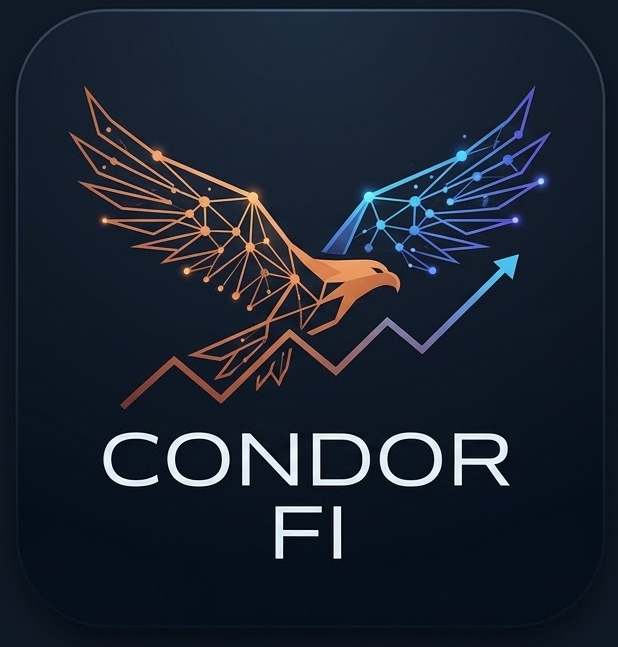
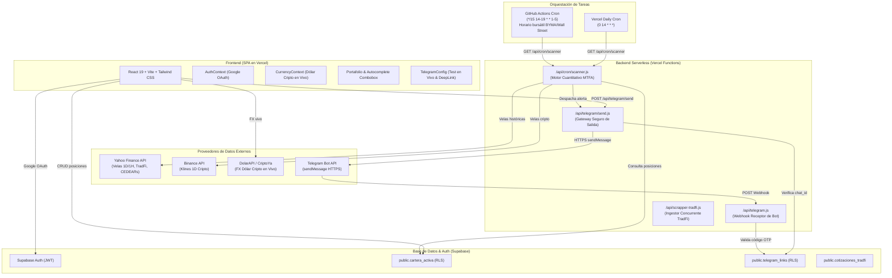

# 🦅 CondorFi - Quantitative Trading Terminal

<div align="center">



**Plataforma institucional para la gestión de portafolios y análisis cuantitativo de mercados (TradFi y Cripto).**  
Diseñada para el inversor activo en mercados globales y en la plaza financiera argentina (BYMA / CEDEARs / Cripto / Wall Street).

[](https://react.dev/)
[](https://vitejs.dev/)
[](https://tailwindcss.com/)
[](https://supabase.com/)
[](https://vercel.com/)
[](https://core.telegram.org/bots/api)
[](LICENSE)

[🌐 Demo en Vivo](https://condorfi.vercel.app) • [📱 Bot Oficial @CondorFi_bot](https://t.me/CondorFi_bot)

</div>

---

## 📌 Visión General

**CondorFi** es una terminal cuantitativa de grado institucional que unifica el monitoreo *Mark-to-Market* en vivo, la ingestión masiva y concurrente de cotizaciones financieras y un motor algorítmico de alertas vía Telegram basado en análisis técnico matemático (MTFA - *Multi-Timeframe Analysis*).

Resuelve la dispersión de activos de los inversores argentinos y de la región, permitiendo consolidar en una única cartera:
* **CEDEARs y Renta Fija Local (.BA / BYMA)** con tipo de cambio implícito (CCL).
* **Acciones y ETFs Globales (Wall Street / NYSE / NASDAQ)** en USD.
* **Criptoactivos y Stablecoins (USDT, BTC, ETH, SOL)** cruzados con el Dólar Cripto en tiempo real.

---

## ✨ Características Principales

### 💵 Gestión Multidivisa y FX en Vivo
* **Cotización Cruzada en Tiempo Real (ARS/USD):** Integración en vivo con cotizaciones de arbitraje y Dólar Cripto, descartando valores estáticos o mocks.
* **Lógica Inteligente de CEDEARs (.BA):** Detección automática de instrumentos locales de BYMA; si el activo finaliza en `.BA`, el sistema reconoce que su precio base ya incorpora el Contado con Liquidación (CCL) implícito, evitando sobrevaluaciones accidentales por doble conversión FX.
* **Autocomplete de Activos sin Límites:** Buscador combobox unificado sobre el catálogo total de Acciones, ETFs, Bonos Soberanos, Cripto e Índices.

### 📐 Motor Cuantitativo Automatizado (MTFA & RSI)
* **Algoritmo de Alisado Exponencial de Wilder:** Cálculo fiel del Índice de Fuerza Relativa (RSI de 14 períodos) en JavaScript puro, superando las distorsiones de las medias móviles simples (SMA).
* **Reglas de Disparo Cuantitativas:**
  * 🟢 **Señal de Compra (Sobreventa extrema):** $\text{RSI} < 30$
  * 🔴 **Señal de Venta (Sobrecompra extrema):** $\text{RSI} > 70$
* **Control de Riesgo de Portafolio:** Alertas complementarias de *Take Profit* ($\ge +10\%$) y *Stop Loss / Riesgo* ($\le -7\%$) sobre costo base promedio.

### 📱 Alertas Instantáneas vía Telegram Bot
* **Bot Oficial [@CondorFi_bot](https://t.me/CondorFi_bot):** Integrado mediante Webhooks serverless (`/api/telegram.js`).
* **Vinculación Segura OTP & Deep-Linking:** Generación de códigos unívocos (ej. `CDF-9K42`) y redirección con un clic a `https://t.me/CondorFi_bot?start=CODIGO`.
* **Despacho Universal de Alertas (`/api/telegram/send.js`):** Endpoint privado que valida la sesión autenticada del operador en Supabase y despacha mensajes estructurados con soporte de Markdown.
* **Test de Conectividad en Vivo:** Botón interactivo en frontend para validar en 1 segundo la recepción de alertas en el teléfono del usuario.

### 🛡️ Aislamiento Institucional Multi-Tenant (RLS)
* **Row Level Security en PostgreSQL:** Políticas estrictas de Supabase donde cada fila de `cartera_activa` y `telegram_links` está ligada al `auth.uid()`.
* **Privacidad Total:** Es matemáticamente imposible que un usuario consulte, modifique o envíe alertas al portafolio o chat_id de otro operador.
* **Autenticación Híbrida:** Google OAuth 2.0 y Magic Link / Email & Password, con muro de registro para proteger las herramientas analíticas de la terminal.

---

## 🏗️ Arquitectura Técnica y Stack



---

## 🚀 Desafíos Técnicos Resueltos

### 1. Arquitectura de Notificaciones Webhook Segura
* **El Problema:** Asociar de manera confiable un usuario autenticado en la web con su cuenta de Telegram sin exponer identidades ni sufrir colisiones entre cuentas.
* **La Solución:** Sistema de vinculación mediante One-Time Passwords (OTP) alfanuméricos con deep-linking (`/start CODIGO`). El Webhook oficial consulta Supabase con Service Role Keys para validar el código, asocia el `telegram_chat_id` correspondiente y activa la verificación RLS instantáneamente, permitiendo al frontend actualizarse en tiempo real mediante Supabase Channels y polling defensivo.

### 2. Optimización Serverless y Límites de Payload (Vercel)
* **El Problema:** El scraper de activos masivos devolvía arrays consolidados con cientos de instrumentos financieros con indicadores técnicos, provocando el fallo `Response data too large` en servicios de cron externos y cuellos de botella de memoria en Node.js.
* **La Solución:** Desacople estricto entre ingestión y telemetría HTTP. Los datos se persisten en lote (`bulk insert`) en Supabase y la función retorna un payload ultraligero de confirmación (~150 bytes con status, tiempo de ejecución y total de filas procesadas), asegurando estabilidad 24/7 sin bloqueos por memoria.

### 3. Automatización de Alta Frecuencia en Horario Bursátil
* **El Problema:** Las cuentas gratuitas de Vercel (Hobby) limitan los cron jobs a una ejecución diaria (`0 * * * *` causaba `Build Failed`).
* **La Solución:** Pipeline automatizado mediante **GitHub Actions** configurado con la expresión cron `*/15 14-19 * * 1-5`. Esto asegura ejecuciones de alta frecuencia cada 15 minutos exclusivamente durante las ruedas bursátiles de BYMA y Wall Street (11:00 a 17:00 hora de Argentina), optimizando recursos y manteniendo `vercel.json` 100% compatible.

### 4. Fidelidad Matemática del RSI (Wilder's Smoothing)
* **El Problema:** Las librerías genéricas de análisis técnico suelen aproximar el RSI utilizando medias móviles simples (SMA), generando señales falsas de sobrecompra o sobreventa en activos de alta volatilidad.
* **La Solución:** Implementación fiel en JavaScript moderno del método original de J. Welles Wilder: primer ciclo sobre las primeras 14 velas seguido de suavizado exponencial ponderado `(avgGain * 13 + gain) / 14` para el resto de la serie histórica.

---

## 💻 Instalación y Configuración Local

### Prerrequisitos
* Node.js v20+ o v22+
* Cuenta en [Supabase](https://supabase.com)
* Bot de Telegram creado en [@BotFather](https://t.me/botfather)

### 1. Clonar el repositorio
```bash
git clone https://github.com/edumoyano86/CondorFi.git
cd CondorFi
```

### 2. Instalar dependencias
```bash
# Dependencias raíz y del frontend
npm install
npm --prefix condorfi-ui install
```

### 3. Configurar variables de entorno
Crea un archivo `.env` en la raíz y en `condorfi-ui/`:

```env
# Supabase
VITE_SUPABASE_URL=https://tu-proyecto.supabase.co
VITE_SUPABASE_ANON_KEY=tu_anon_public_key
SUPABASE_SERVICE_ROLE_KEY=tu_service_role_secret_key

# Telegram Bot API
TELEGRAM_BOT_TOKEN=123456789:ABCdefGHIjklMNOpqrsTUVwxyz

# Cron & Endpoints (Opcional)
CRON_SECRET=tu_secreto_para_proteger_los_cron_endpoints
```

### 4. Inicializar base de datos
Ejecuta el script SQL incluido en tu consola de Supabase:
```bash
# Contenido disponible en:
schema.sql
```

### 5. Iniciar en entorno de desarrollo
```bash
npm run dev
```
La aplicación estará disponible en `http://localhost:5173`.

---

## 📊 Formato de Alertas Cuantitativas (Telegram)

Cuando el escáner detecta condiciones de sobrecompra o sobreventa en activos de tu portafolio, despacha una notificación estructurada como la siguiente:

```text
🦅 ALERTA MTFA: VIG.BA | 🟢 SEÑAL DE COMPRA (Sobreventa RSI: 26.40) | Precio Actual: $ 10.310,00

🦅 ALERTA MTFA: VIG.BA
────────────────────────
🟢 SEÑAL DE COMPRA (Sobreventa RSI: 26.40)
💵 Precio Actual: $ 10.310,00

📊 Análisis Técnico Cuantitativo:
• Indicador: RSI (14 períodos de Wilder)
• Lectura: 26.40 (Zona de Sobreventa extrema < 30)
• Posición en Cartera: 11 nominales
• Precio Base de Compra: $ 10.500,00

💡 Interpretación Cuantitativa: Agotamiento vendedor detectado en temporalidad diaria. Evaluar compras tácticas o rebalanceo alcista.
────────────────────────
⚙️ CondorFi Quantitative Trading Terminal
```

---

## 🗺️ Roadmap & Posibles Mejoras

- [x] Gestión de portafolio Mark-to-Market con conversión FX en vivo.
- [x] Soporte estricto de CEDEARs BYMA (.BA) con CCL implícito.
- [x] Motor de escaneo técnico con cálculo de RSI(14) de Wilder.
- [x] Integración de Telegram Bot con autenticación OTP y Webhooks.
- [x] Automatización bursátil mediante GitHub Actions.
- [x] **Historial de Alertas en Dashboard:** Registro auditable en Supabase y Centro de Notificaciones en la UI con feed en vivo.
- [x] **Modo Demostración / Invitado ("One-Click Demo"):** Botón de acceso inmediato desde la Landing/Login sin registro obligatorio.
- [x] **Confluencia Multi-Temporal (MTFA 1D + 1H):** Confirmación combinada de micro-impulso horario y macro-tendencia diaria (Wilder RSI).
- [x] **Curva de Rendimiento Histórico (Equity Curve):** Gráfica interactiva de evolución patrimonial comparada contra el S&P 500 (SPY) con cálculo de Alpha, Beta y Sharpe Ratio.

---

## 📜 Disclaimer

> **Aviso Legal:** CondorFi es un desarrollo de software con fines demostrativos y de investigación cuantitativa. Las señales, indicadores técnicos y proyecciones calculadas por el sistema no constituyen asesoramiento financiero, recomendaciones de compra/venta ni intermediación bursátil bajo ninguna circunstancia.

